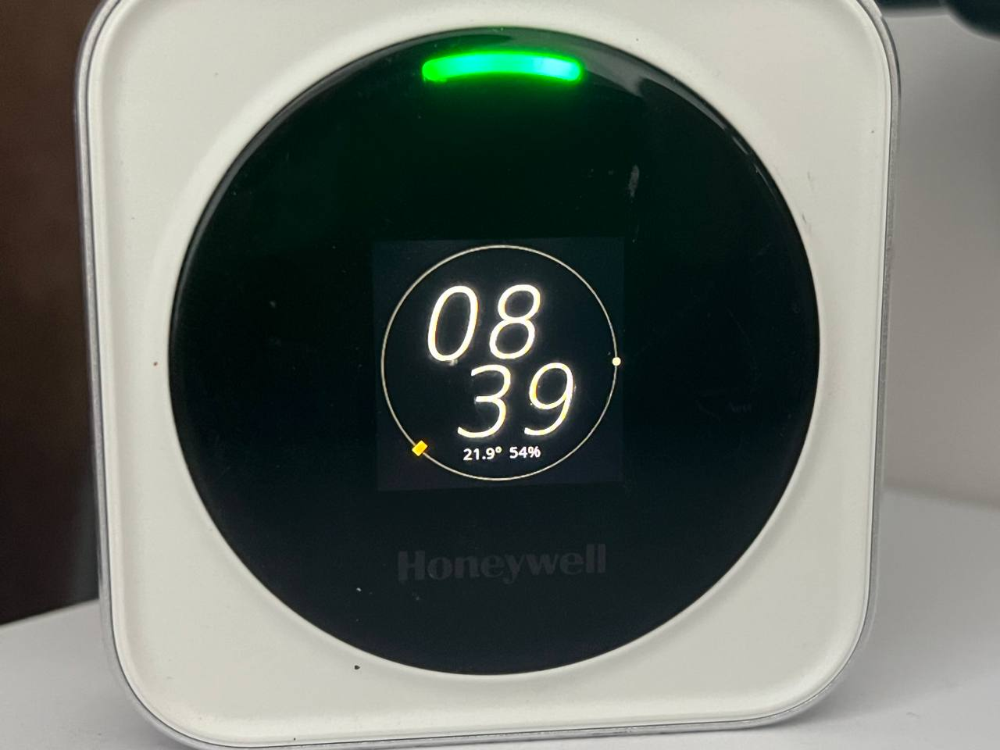

# HTRAM · custom firmware

Custom firmware for the **Honeywell Transmission Risk Air Monitor** — a CO2
monitor whose vendor shut its cloud down. The stock firmware is replaced
entirely: ESPHome on the ESP32, hand-written bare-metal on the GD32F150 that
owns the sensors, the panel and the buttons.



> Looking for the Home Assistant integration that talks to the **stock**
> firmware over BLE and MQTT? That lives in
> [reidMaks/ha-htram](https://github.com/reidMaks/ha-htram). This repository
> replaces the firmware instead of speaking to it.

## What the device does now

- **A room dashboard** on the 240 × 240 panel: temperature, relative humidity
  and CO2 shown together in a high-contrast dark theme with JetBrains Mono and
  compact icons.
- **CO2 status** is shown with a color-coded leaf (green / amber / red) using
  the configurable ppm thresholds. The front LED bar tracks the same CO2
  quality in normal conditions.
- **An alarm clock** that rings from the device, not from an automation.
- **Air raid alerts & threat tracking**: Real-time alerts powered by
  [JAAM (jaam.net.ua)](https://jaam.net.ua) over its Fusion WebSocket API
  (`ws.jaam.net.ua/data_fusion_v1`), with a persistent status icon, threat
  sounds, and blinking yellow/red front LEDs. The five room profiles use the
  Ivano-Frankivsk region (JAAM region ID 13).
- **Five room profiles**: Living room, bedroom, office, kids' room 1 and kids'
  room 2. Each has a room-specific Home Assistant identity and OTA image.
- **Room-aware OTA from this fork**: Each profile downloads its matching ESP32
  binary from the public `warp0/htram-esphome` GitHub Release; GD32 firmware
  and SPI Flash assets are shared across rooms.
- **Standby** on a long press, with a charge screen the GD32 draws by itself.
- **Cached graphic assets on SPI Flash (v1.2.0)**: 25 monochrome bitmap icons
  (weather, threats, alerts, Tryzub) reside in external SPI Flash (`0x040000`)
  and are blitted on-demand by the GD32 with zero ESP32 DRAM overhead (14-byte
  UART draw command).
- **Two-stage OTA with autonomous rollback (v1.2.0)**: ESPHome OTA for the
  ESP32, and staged SPI Flash OTA for the GD32 with Boot Guard self-test
  protection (automatic hardware rollback from backup slot if new firmware
  fails to confirm within 15 s). Legacy SRAM flasher remains available as
  automatic fallback.

## Layout

| | |
| --- | --- |
| `esphome/` | the ESP32 configuration, modular features (`features/`), custom components (`htram_gd32`) |
| `firmware/gd32/` | the GD32F150 firmware — sensors, panel, button, buzzer, SPI Flash driver, binary protocol |
| `tools/` | device management CLI (`device.py`), simulator UI preview (`preview_ui.py`), asset pipeline |
| `tools/swd/` | SWD flashing, rescue, SRAM probes, ROM bootloader |
| `tests/` | automated test suites: GD32 C99 (Unity), ESPHome C++ (Unity), Python tools & YAML configs |
| `docs/` | conversion runbook, hardware map, firmware spec, bench procedures, test plan, release notes |

## Getting started

**Converting a stock device for the first time?** Start at
[docs/CONVERSION.md](docs/CONVERSION.md) — it carries the whole sequence, the
soldering, and the one step that cannot be undone. `tools/convert.py --status`
reads the device and tells you where you are in it.

Once converted, both chips update over the air:

```bash
uv sync
cp esphome/secrets.yaml.example esphome/secrets.yaml   # fill it in
uv run esphome run esphome/htram.yaml
```

For a room-specific build, use one of:
`esphome/htram-living.yaml`, `esphome/htram-bedroom.yaml`,
`esphome/htram-office.yaml`, `esphome/htram-kids-1.yaml`, or
`esphome/htram-kids-2.yaml`. GitHub Releases publish a matching
`htram-<room>.bin` for each profile so one-click OTA preserves its room identity.

To preview the room dashboard without an ESP32 or Pico, install Docker and run
`make preview-dashboard-docker`. The `Dockerfile.sim` image keeps Python and
system build dependencies in cached layers; ESPHome and PlatformIO caches are
kept in named Docker volumes between preview runs.

Run test suites locally before flashing:
```bash
make test                               # runs GD32, ESPHome C++, Python tools & config tests
```

The GD32 side builds with `arm-none-eabi-gcc` and flashes over the air through
the ESP:

```bash
make ota-gd32 DEVICE=<alias-or-ip>      # e.g. DEVICE=office
make flash-assets DEVICE=<alias-or-ip>   # upload UI graphic assets
```

**Before touching the GD32, read [docs/BENCH.md](docs/BENCH.md).** It carries
the power-on order for the debug probe and the recovery procedure, both of
which were written after losing a day to not having them.


## Firmware Compatibility & Upgrade Notes (v1.3.0)

Version **v1.3.0** introduces streaming hardware-accelerated **TGA 16-bit RGB565 Run-Length Encoding (RLE)** (`CMD_TYPE_DRAW_RECT_RLE` / `0x16`) across the inter-chip UART link (921,600 baud). The GD32 decompressor runs in-flight using only **4 bytes of SRAM**, eliminating screen transition latency (<15 ms wire time) and achieving up to **85× compression** for modal screen invalidations.

This builds on the architecture introduced in **v1.2.0**, which incorporates the external SPI Flash (Winbond W25Q32, 4 MB) for **staged OTA with autonomous hardware rollback** and **cached asset blitting** (zero ESP32 DRAM overhead).

### Compatibility Matrix

| GD32 Firmware | ESPHome Firmware | Status & Behavior |
|---|---|---|
| **v1.3.0+** | **v1.3.0+** | **Full feature set**: Hardware RLE stream compression (<15 ms modal transitions), Staged OTA, autonomous Boot Guard rollback, fast cached assets (0 B DRAM, 14 B UART). |
| **v1.2.0** | **v1.3.0+** | **Compatible with fallback**: ESPHome detects pre-RLE GD32 and automatically falls back to uncompressed `CMD_DRAW_RECT` (`0x10`). Staged SPI Flash OTA and cached assets continue working. |
| **v1.3.0+** | **v1.2.0** | **Compatible**: GD32 accepts uncompressed rectangles from older ESPHome. |
| **v1.0.x / v1.1.x** | **v1.3.0+** | **Compatible with fallback**: Telemetry, sensors, LEDs, buzzer, clock face, and OTA update work. ESPHome falls back to uncompressed drawing and legacy ROM bootloader OTA. |

### Upgrade Procedure to v1.3.0
To transition a device smoothly:
1. **Flash GD32 v1.3.0**: `make ota-gd32 DEVICE=<device>`
2. **Flash Assets** (if not already flashed): `make flash-assets DEVICE=<device>`
3. **Flash ESPHome**: `make ota-esp DEVICE=<device>` (or `make update-all` for the fleet)

## Legal, research and safety

This is an independent, non-commercial interoperability and repair effort on
hardware whose vendor discontinued its service. It is **not** affiliated with
Honeywell, GigaDevice or Espressif; product names are used descriptively.

No vendor firmware, dumps or proprietary assets are redistributed here. Third
party material is limited to fonts, each with its licence beside it in
[`esphome/fonts/`](esphome/fonts/).

Flashing, soldering and SWD work risk damaging the hardware or the battery.
Everything here is provided **as is**, without warranty; proceed at your own
risk.
